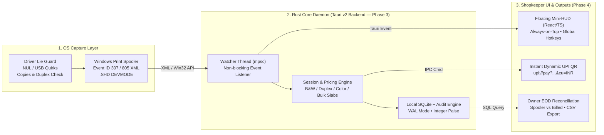

# PrintLedger (`Printust`)

**Passive Windows Print-Shop Billing & Owner Leakage Audit Utility**

PrintLedger is a local-first Windows desktop utility that hooks into the Windows Print Spooler without blocking the operator—tracking every print job passively in the background, handling Indian print-shop billing slabs (B&W, Duplex, Color, Bulk, plus add-ons like spiral binding/lamination), generating offline Dynamic UPI QR codes, and logging immutable spooler trails for End-of-Day (EOD) owner reconciliation.

> **Current Build Status:** **Phase 1 — Days 1 & 2 Complete** (Python `pywin32` Print Spooler spike, silent `NUL`-port `HP Universal Printing PCL 6` test lab, scrubbed Event ID `307`/`805` XML fixtures, and empirical [Driver Lie Matrix](docs/driver_lie_matrix.md)). Day 3 (`.SHD` / `DEVMODE` binary inspection) and Phases 2–6 (Rust + Tauri v2 + SQLite) are scheduled on the 21-day roadmap below.

---

## 1. Product Thesis & Core UX Rules

A manual "page calculator" fails in real print shops—operators already multiply pages × rate in their heads. The real wedge is **Passive Auto-Billing + Owner Leakage Audit**:

- **Zero-Blocking Capture:** No modal `"Are you done?"` popups after every print job. During rush-hour WhatsApp Web / Chrome PDF printing (`Ctrl+P` every ~15 seconds), focus-stealing dialogs kill shop throughput.
- **Always-On-Top Mini-HUD (Planned — Phase 4):** Compact, non-focus-stealing bottom-right overlay (`~320×190px`) displaying live customer session totals (`Jobs | B&W / Color | ₹ Total`).
- **Keyboard-First Speed (Planned — Phase 4):** Global OS hotkeys (`Ctrl+Shift+Space` close bill & start next customer, `Ctrl+Shift+J` deduct 1 jammed page, `Ctrl+Shift+H` toggle HUD) plus 1-click chips (`Spiral Binding`, `Lamination`, `Xerox`).
- **Offline-First Guarantee:** 100% local SQLite ledger (integer paise math, WAL mode) and offline `upi://pay?...` SVG QR encoding—works even with zero shop internet.
- **Strict v1 Scope Lock:** Local-first single-PC Windows desktop utility only (no cloud sync, multi-PC networking, SNMP hardware polling, or AI chat in v1).

---

## 2. Target Architecture (3-Layer Local-First)



### Target SQLite Schema (Integer Paise — Planned Phase 2/3)

All currency values are stored as `INTEGER` paise (never floating-point) with append-only `print_jobs` rows for crash-safe owner auditing:

- `sessions` (`id`, `started_at`, `closed_at`, `status` [`ACTIVE`/`PAID_UPI`/`PAID_CASH`/`KHATA`/`VOID`], `total_amount_paise`, `jam_deducted_pages`)
- `print_jobs` (`id`, `session_id`, `windows_job_id`, `printer_name`, `doc_name`, `raw_pages`, `raw_copies`, `effective_pages`, `is_duplex`, `is_color`, `driver_anomaly_flag`, `captured_at`)
- `session_addons` (`id`, `session_id`, `label`, `qty`, `unit_price_paise`)
- `pricing_rules` (`rule_key`, `rate_paise`)

---

## 3. Phase 1 Findings: How Windows Print Drivers Lie

Before writing Rust/Tauri code, **Phase 1 (Days 1–2)** tested real spooler output against `ShopTest_PCL6` (`HP Universal Printing PCL 6` bound to silent local port `NUL`). Across **8 live captured Chromium print jobs (`JobId 3`–`10`, Cases 1–5 verified; MS Word Case 6 pending)** verified via `spooler_spike.py` (with 2 scrubbed Event `805` & `307` sample fixtures checked into [spike/raw_xml_samples/](spike/raw_xml_samples)), we observed:

1. **`PagesPrinted` Already Includes `Copies` (Chromium + HP PCL6):**
   - `JobId 10` (`3-page × 3 copies`): Event `805` reported `Copies=3` (`GdiJobSize=9240576`), while Event `307` reported `PagesPrinted=9` (`3 × 3`).
   - `JobId 5` & `JobId 9` (`2-page × 2 copies`): Event `805` reported `Copies=2` (`GdiJobSize=7012352`), while Event `307` reported `PagesPrinted=4` (`2 × 2`).
   - **Takeaway:** Blindly multiplying `PagesPrinted * Copies` would overbill 2×–3× on unrolled EMF/GDI streams.
2. **Duplex Is Completely Invisible in Event `805` & `307`:**
   - Event `805` (`RenderJobDiag`) only emitted `{JobId, GdiJobSize, ICMMethod, Color, XRes, YRes, Quality, Copies, TTOption}` with **zero Duplex tags**.
   - `JobId 7` (`4-page Duplex`) emitted `PagesPrinted=4` (sides) instead of `2` physical sheets—confirming **Day 3 `.SHD` shadow file (`DEVMODE.dmDuplex`) inspection is mandatory**.
3. **`Color` Enum Semantics:** `Color=1` = Black & White / Grayscale (`DMCOLOR_MONOCHROME`), `Color=2` = Color (`DMCOLOR_COLOR`).
4. **Filename Masking:** Chromium print pipelines set Event `307` `Param2` (`DocumentName`) to generic `"Print Document"` across all jobs.

See full per-case measurements in [docs/driver_lie_matrix.md](docs/driver_lie_matrix.md).

---

## 4. Repository Structure (Current)

```text
Printust/
├── docs/
│   ├── driver_lie_matrix.md      # 6-case empirical test table + findings
│   └── spike_findings.md         # Day 3: Locked Duplex + Phase 3 Rust capture strategy
├── spike/
│   ├── requirements.txt          # Pinned pywin32==312
│   ├── setup_env.ps1             # Admin PowerShell helper (PrintService log + NUL port + printer)
│   ├── spooler_spike.py          # Real-time Event ID 307 & 805 watcher + JobId correlator
│   ├── shd_devmode_probe.py      # Day 3: Win32 JOB_INFO_2 (DEVMODE) + .SHD probe
│   └── raw_xml_samples/          # Scrubbed Event 307 & 805 XML fixtures (local logs/PII gitignored)
├── .gitignore
└── README.md
```

---

## 5. Running the Phase 1 Spooler Spike (Windows)

### Prerequisites (Administrator PowerShell — Once)
Enable `Microsoft-Windows-PrintService/Operational` logging and bind a real PCL6/PostScript driver (not `Microsoft Print to PDF`) to local port `NUL`:

```powershell
Set-ExecutionPolicy -Scope Process -ExecutionPolicy Bypass
.\spike\setup_env.ps1
```

### Run the Real-Time Watcher
```powershell
python -m venv spike\.venv
.\spike\.venv\Scripts\python.exe -m pip install -r .\spike\requirements.txt
.\spike\.venv\Scripts\python.exe .\spike\spooler_spike.py
```

- Polls `Microsoft-Windows-PrintService/Operational` every `0.40s` with XPath `*[System[(EventID=307 or EventID=805)]]`.
- Skips historical records on startup (pass `--include-existing` to backfill prior events).
- Exports raw XML fixtures to `spike/raw_xml_samples/` (only scrubbed sample fixtures are committed; local dumps & `spike/events.jsonl` are gitignored).

---

## 6. 21-Day Execution Roadmap (Nov 24 – Dec 14, 2026 | 42 Hours)

- [ ] **Phase 1 — Days 1–2:** Virtual `NUL` printer (`ShopTest_PCL6`), PrintService operational logging, `spooler_spike.py` live watcher, scrubbed XML fixtures, Cases 1–5 verified in [Driver Lie Matrix](docs/driver_lie_matrix.md) *(Case 6 MS Word non-Chromium comparison pending)*
- [x] **Phase 1 — Day 3:** Paused queue `JOB_INFO_2` (`DEVMODE` `dmCopies` / `dmDuplex` / `dmColor`) vs `.SHD` probe & locked [spike_findings.md](docs/spike_findings.md)
- [ ] **Phase 2 (Days 4–6):** Surgical Rust bootcamp (`pricing.rs` paise math, `rusqlite` schema prototype, `mpsc` channels, minimal `windows-rs` FFI)
- [ ] **Phase 3 (Days 7–11):** Tauri v2 scaffold, Rust Event Log watcher (`quick-xml`), Driver Lie Guard & deduplication, session state machine, WAL SQLite & Owner EOD audit engine
- [ ] **Phase 4 (Days 12–15):** Non-focus-stealing always-on-top Mini-HUD (React/TS), global hotkeys, offline Dynamic UPI QR, Owner EOD dashboard & CSV export
- [ ] **Phase 5 (Days 16–18):** Physical USB printer stress test, native `.msi` installer (`tauri-plugin-autostart`), and real print-shop pilot
- [ ] **Phase 6 (Days 19–21):** Performance benchmarks (`<25 MB` RAM target, 10k-job SQLite query timing), `v1.0.0` release, demo video, and portfolio case study
